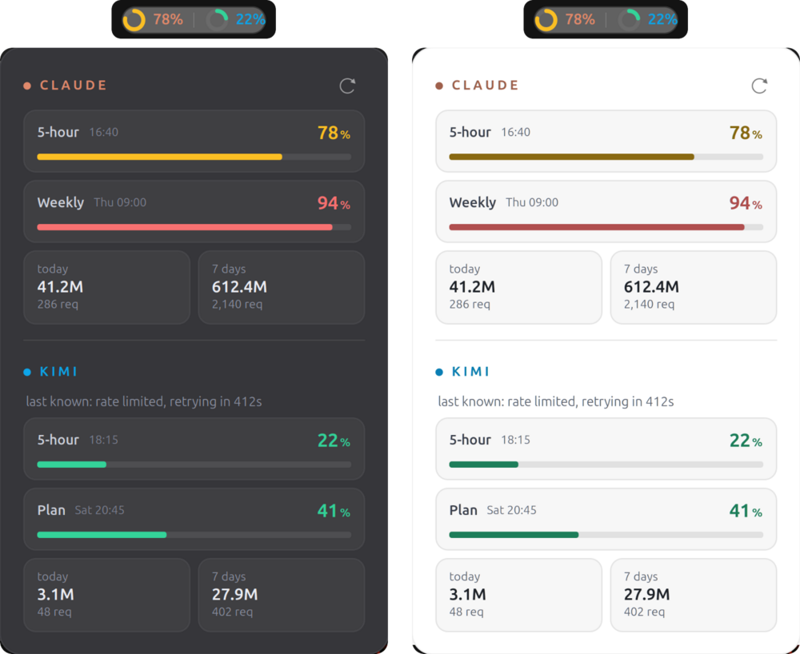

# agent-usage

[](https://github.com/pgiahuy/agent-usage/actions/workflows/ci.yml)
[](LICENSE)
[](https://release.gnome.org/)

Claude Code and Kimi Code plan usage in the GNOME top bar.



- **Plan usage from the provider.** How much of each quota window is used, read
  from the provider's own API, never estimated: Claude Code's 5-hour and weekly
  windows, Kimi Code's 5-hour window and plan. Bars turn amber at 75% and red
  at 90%.
- **Tokens and requests** today and over the last 7 days, per model, counted
  from the local session logs. These keep working when a quota endpoint does
  not.
- **Says how old the figures are.** Each agent shows when its quota was last
  fetched, and a reading that could not be refreshed is marked as last known.
- **A terminal view**, `agent-usage`, with the same reading on any desktop.

## Requirements

- GNOME Shell 48, 49 or 50 for the panel indicator. The shell will not load an
  extension whose `metadata.json` does not list its version.
- Python 3.8 or newer, standard library only.
- A systemd user session to run the collector. Without one, run
  `agent-usage --daemon` yourself.
- Claude Code or Kimi Code, signed in with a subscription. An API-key sign-in
  gives token counts but no quota bars, because the quota is per plan.

There is no key to paste: the collector uses the token each tool saved when you
signed in. A tool that is not installed is not shown.

## Install

```sh
git clone https://github.com/pgiahuy/agent-usage.git && cd agent-usage
./install.sh
```

Log out and back in once. GNOME Shell only picks up a new extension at login.

Everything goes under your home directory:

| Path | Contents |
| --- | --- |
| `~/.local/share/agent-usage/` | the collector |
| `~/.local/bin/agent-usage` | the command |
| `~/.local/share/gnome-shell/extensions/agent-usage@pgiahuy.github.io/` | the extension |
| `~/.config/systemd/user/agent-usage.service` | the service |
| `~/.cache/agent-usage/` | readings and ring icons |

To upgrade, run `./install.sh` again. It reloads the indicator without a
logout, except when `extension.js` or `metadata.json` changed or the previous
install had no preferences page; it says so when that happens.

For a system-wide `.deb` or an APT repository, see
[docs/packaging.md](docs/packaging.md).

## Usage

Click the indicator for the popup. **Refresh** fetches the quota now instead of
at the next check, and renews a token that has expired.

The settings are under Agent Usage in the Extensions app: how often to check
quota (2 to 60 minutes, default 5), which agents to show, the popup layout
(tiles, compact or large numbers) and the panel style (ring or text).

From a terminal:

```sh
agent-usage            # the reading
agent-usage --json     # the reading as JSON
agent-usage --daemon   # the collector, in the foreground
```

If Claude Code or Kimi Code keeps its data elsewhere, set `CLAUDE_CONFIG_DIR`
or `KIMI_CODE_HOME` in `~/.config/environment.d/agent-usage.conf`. A systemd
user service does not read your shell profile.

```
CLAUDE_CONFIG_DIR=/data/claude
KIMI_CODE_HOME=/data/kimi-code
```

## Troubleshooting

Run the read-only check first. It names the problem and the command to fix it.

```sh
./tools/doctor.sh
```

- **Nothing in the panel.** Usually one of: the session was not restarted
  after the install; user extensions are switched off
  (`gsettings get org.gnome.shell disable-user-extensions` prints `true`); or
  GNOME Shell is newer than `extension/metadata.json` lists.
- **"agent-usage daemon is not running".** Check
  `systemctl --user status agent-usage` and
  `journalctl --user -u agent-usage -n 50`.
- **"rate limited, retrying in ...".** The provider limits how often its usage
  endpoint is asked. The collector backs off on its own and keeps the last
  reading on screen.
- **Kimi shows "token expired".** Press Refresh. If it then says
  "kimi is running", the token renews the next time that `kimi` session talks
  to Kimi.

## Uninstall

```sh
./uninstall.sh           # keeps ~/.cache/agent-usage
./uninstall.sh --purge   # removes it too
```

The indicator leaves the panel at once.

## Privacy

The collector talks only to the providers, with your own token: quota checks
to `api.anthropic.com` and `api.kimi.com`, and on Refresh, a token renewal.
There is no telemetry. [SECURITY.md](SECURITY.md) lists exactly what is read, sent and
written.

## Contributing

Issues and pull requests are welcome: see [CONTRIBUTING.md](CONTRIBUTING.md)
and [docs/hacking.md](docs/hacking.md). Report security problems privately, as
described in [SECURITY.md](SECURITY.md). Participation is covered by the
[code of conduct](CODE_OF_CONDUCT.md).

## License

[MIT](LICENSE)
